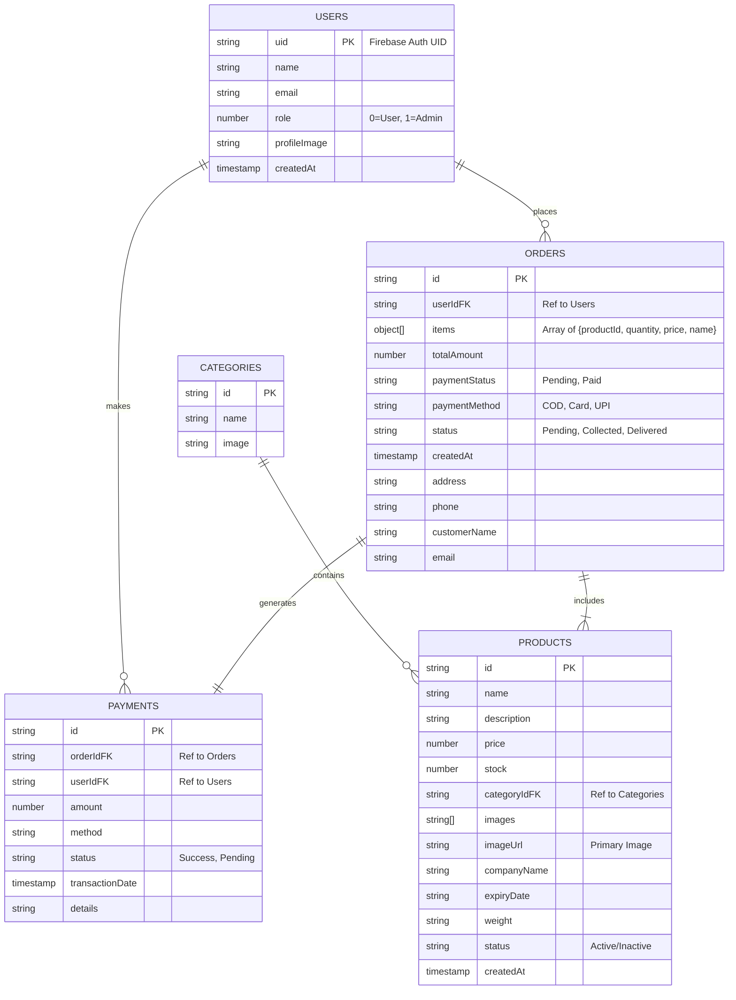
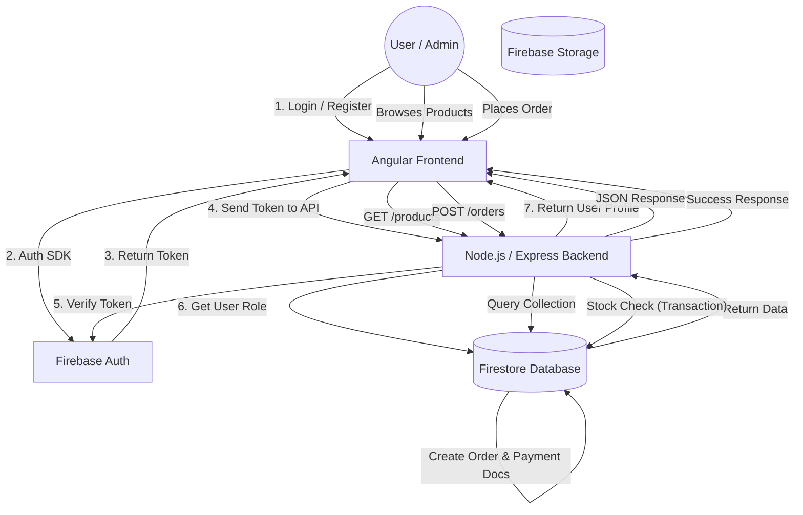

# Project Documentation

## 1. Project Overview
This project is a full-stack e-commerce application for a Pet Food Store ("Fean"). It features a responsive Frontend built with Angular and a robust Backend built with Node.js and Express, utilizing Firebase Firestore for the database and Firebase Authentication for user management.

**Key Features:**
- User Authentication (Login/Register)
- Product Browsing & Categorization
- Shopping Cart Management
- Order Placement with Stock Verification
- Admin Dashboard for Product & Order Management
- Secure Payment Handling (Simulation)

---

## 2. Entity-Relationship (ER) Diagram
The following diagram illustrates the data entities and their relationships within the Firebase Firestore database.

---

## 3. Data Flow Diagram
This diagram shows how data flows through the system, from the User Interface to the Database.

---

## 4. Key Algorithms & Logic

### A. Order Placement (Transaction Safe)
To ensure inventory integrity, order placement uses a database transaction.

**Algorithm:**
1.  **Receive Request**: Backend receives order details (`items`, `user`, `paymentInfo`).
2.  **Start Transaction**: logic is wrapped in a Firestore Transaction.
3.  **Read Step**: Fetch current documents for all `productIds` in the order.
4.  **Validation**:
    *   Check if Product exists.
    *   Check if `Product.stock >= Order.quantity`.
    *   *If any check fails, Abort Transaction and Return Error.*
5.  **Write Step**:
    *   Decrement `Product.stock` by `Order.quantity` for each item.
    *   Create new `Order` document with status `Pending` (or `Paid` if online payment).
    *   Create new `Payment` document recording the transaction.
6.  **Commit**: Save all changes atomically.
7.  **Response**: Return success message to Frontend.

### B. User Authentication & Authorization
The system uses a hybrid approach with Firebase SDK and Custom Backend Verification.

**Flow:**
1.  **Client-Side**: User logs in using Firebase SDK.
2.  **Token Generation**: Firebase returns a JWT (ID Token).
3.  **Backend Request**: Client sends this ID Token to `POST /auth/login`.
4.  **Verification**: Backend uses `firebase-admin` to verify the ID Token signature and validity.
5.  **Role Retrieval**: Backend fetches the `User` document from Firestore using the `uid` from the token to determine if the user is an `Admin` or `Customer`.
6.  **Session Start**: Backend validates the login and returns the user's role and profile data.

---

## 5. API Endpoints

| Method | Endpoint | Description | Auth Required |
| :--- | :--- | :--- | :--- |
| **Auth** | | | |
| POST | `/api/auth/register` | Register new user in DB | No |
| POST | `/api/auth/login` | Verify token & get profile | No |
| **Products** | | | |
| GET | `/api/products` | Get all products | No |
| GET | `/api/products/:id` | Get single product | No |
| POST | `/api/products` | Create product (with image) | Yes (Admin) |
| PUT | `/api/products/:id` | Update product | Yes (Admin) |
| DELETE | `/api/products/:id` | Delete product | Yes (Admin) |
| **Orders** | | | |
| POST | `/api/orders` | Place a new order | Yes (User) |
| GET | `/api/orders` | Get orders (User: Own, Admin: All) | Yes |
| PUT | `/api/orders/:id/status`| Update order status | Yes (Admin) |
| DELETE | `/api/orders/:id` | Delete order | Yes (Admin) |

---

## 6. Production Security & Pre-Deployment
For detailed security hardening guidelines, threat mitigations, and the full 18-point deployment verification matrix, refer to the [Production Security & Hardening Checklist](file:///c:/Users/Samar%20Taibani/Desktop/one/documentation/PRODUCTION_SECURITY_CHECKLIST.md).

